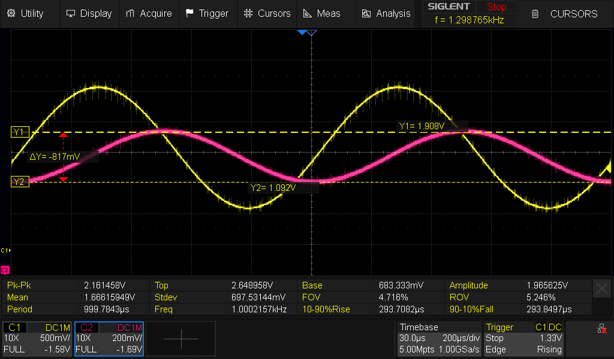
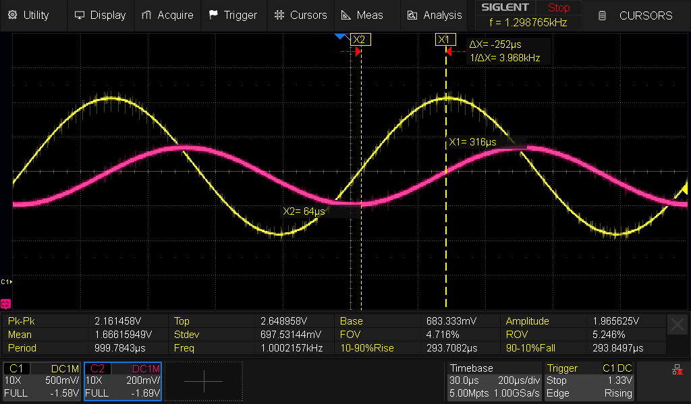
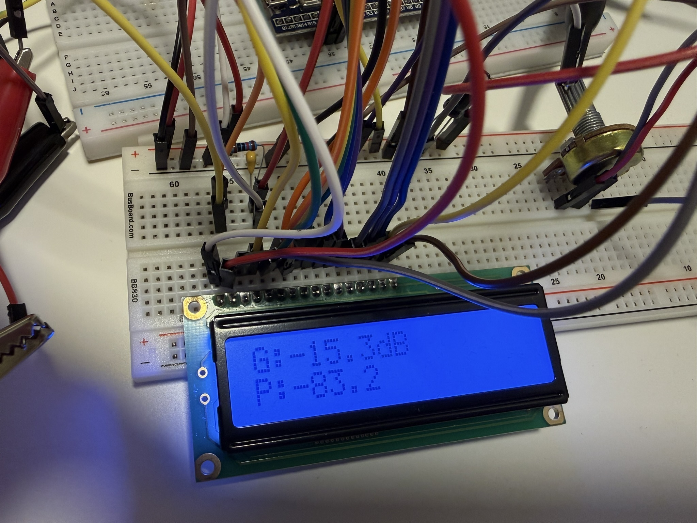

# Gain and Phase Measurement with STM32F103C8T6 (Blue Pill)

The project measures the gain and phase difference for a given input to a linear time invariant system. The measurement is displayed on a 16x2 HD44780 LCD.

Setup and Pinout:

- PA0-PA7: DATA pins for LCD
- PA8: RS pin of LCD
- PA9: RW pin of LCD
- PA10: EN pin of LCD
- PB0: reference analog pin (Uses ADC1)
- PB1: output measurement analog pin (Uses ADC2)

## LCD Display

The LCD display code uses the 8 data pin configuration, which I had available from my earlier projects. The lcd_init() function can be reconfigured to use the 4-pin setup if available pin count is limited.

## ADC Measurement, Gain and Phase Computation

The ADC is set up in the continuous regular dual sampling mode, with 239.5 cycles (max setting) for best accuracy. We sample 239.5+12.5=252 cycles with 12MHz ADC clock, so each sample takes 252/12MHz=21us, which gives sampling frequency of fs=47.62kHz. By nyquist, we want inputs that have frequency less than 23.86kHz, but to calculate zero crossings reliably much lower frequencies are needed.

The gain is calculated by finding the maximum peak value of the recorded signal after subtracting the mean. The peak value of output measurement is divided by peak value of reference measurement. Then, from the `math.h` library, `floorf` function was used to round the result (`floorf(x+0.5f)`), and `log10f` function was used to convert to dB. The log calculation is performed by scaling with 200 instead of 20, to keep one decimal digit of precision.

The phase was calculated by first finding the period of the measured reference. The rising edges that cross the mean are used to find the first and last crossing sample. Then, the period is found by dividing the span from the first to last rising edge crossing by (crossings-1). Then, the first mean crossing of the output is found. The difference between the first mean crossing of reference and output are compared. If it is detected to be more than half a period, the period is subtracted to obtain the negative phase. Then, the difference is divided by the period and scaled by 360 degrees to get the phase difference. The multiplication is performed with 3600, to keep one decimal digit of precision.

## Test Circuit

A simple RC filter with a 100nF polyester capacitor and 10kOhm resistor were used. 

A 1kHz, 2Vpp sinusoidal wave with 1.65V DC offset was used.

## Results

The scope measurement for input and output were used for comparison with measurement and computation performed by the board. This was aimed at reducing the effect of capacitor and resistor tolerances to see the accuracy of the measurement method clearer.

<u>Scope Results</u>

- Gain ratio: 0.3268Vpp/1.9656Vpp = 0.1663
- Gain (dB) = -15.58dB
- Phase: -252us/999.78us * 360° = -90.74°

<u>Blue Pill Results</u>
- Gain ratio: 0.1718
- Gain (dB) = -15.3dB
- Phase: -83.2°

The difference in phase measurement was approximately 7.5°. One sample takes 21us (fs = 47.62kHz). At 1kHz, the signal has 47.62 samples per period. Then one sample gives 360° / 47.62 = 7.56°. Hence, the difference in phase between the oscilloscope and the board is approximately 1 sample. 

The linear gain ratio error was 3.31% compared to the scope.

The error is mostly attributed to measurement precision, as discussed in limitations.

   
  <em>Gain: scope −15.6 dB vs Blue Pill −15.3 dB at 1 kHz</em>

   
  <em>Phase: scope 90.7° lag at 1 kHz</em>

   
  <em>Blue Pill display at 1 kHz: G = −15.3 dB, P = −83.2°</em>

## Limitations and Future Work
- The phase resolution is around 1 sample (7.56° at 1kHz), because mean crossings are located at whole sample positions.
- Gain uses peak value, and noise spikes may affect the result. Detecting the peak in each period and averaging, or using RMS may yield more accurate results.
- The cursor readings were performed manually, so they can affect the comparison of oscilloscope vs board measurement (by roughly 10us). 
- 12 bit ADC and noise limit accuracy.
- This project currently needs external feeding of a sinusoidal input to the system. This may be solved in future iterations by utilizing a step response, where the step would be generated by the microcontroller itself.
- The lags that were measured both on the scope and the hardware are slightly large for an RC filter. The breadboard capacitances, and ADC's effect are candidates to be the reason for this.